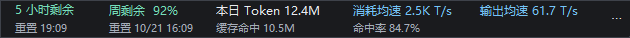

# Codex Usage Bar · Codex 额度条

Windows Codex 桌面版的独立额度悬浮条，顶部居中，随窗口移动和缩放。当前版本：**1.0.7**。

[下载 Windows x64 便携包](https://github.com/Leeroysunfury/codex-usage-bar/releases/download/v1.0.7/codex-usage-bar-1.0.7-windows-x64.zip) · [版本说明](https://github.com/Leeroysunfury/codex-usage-bar/releases/tag/v1.0.7)



## 功能

- 五小时、周剩余额度与各自的系统本地时间重置时间。
- 本日输入与输出 Token 总量，按系统本地时区自然日统计。
- 本日缓存命中量、缓存输入占总输入的命中率。
- 指定桌面对话本轮平均 Token/秒。
- 窄窗口布局、菜单外点击关闭、普通窗口层级与输入法候选窗共存。
- 可选“随 Codex 启动”，最后一个 Codex 窗口关闭后停止额度查询。

这是独立悬浮窗口，不修改 Codex 安装文件，也不发送模型推理请求。

## 直接使用

1. 下载本项目 ZIP 并解压全部文件，保持目录结构。
2. 双击 `bin/CodexUsageBar.exe`。需要 Windows x64 与 .NET Framework 4.x。
3. 打开 Codex，额度条会显示在窗口顶部。右侧 `⋯` 可刷新、指定跟踪对话或开关自动启动。

账号额度需要 Codex 的 ChatGPT 登录状态和可用网络。查询后台优先使用 `CODEX_CLI_PATH` 指定的 CLI，否则自动查找桌面版附带的 CLI。

以下 PowerShell 命令都从项目目录执行，使用相对路径：

```powershell
.\scripts\start.ps1
.\scripts\stop.ps1
Start-Process -FilePath .\bin\CodexUsageBar.exe -ArgumentList --enable-autostart -WindowStyle Hidden
```

菜单“退出额度条”仅退出当前实例，同一次 Codex 窗口会话不会立即重新启动；下次打开 Codex 时再启动。最小化和切到其他应用会隐藏额度条。

## 统计口径

| 指标 | 来源与含义 |
|---|---|
| 两项额度 | 官方 `account/rateLimits/read`，只匹配 300、10080 分钟窗口；显示 `100 - usedPercent` |
| 本日 Token | 本机会话日志中输入、输出累计量的本日增量；缓存输入和推理输出已包含，不重复相加 |
| 缓存命中量 | 本日 `cached_input_tokens` 增量之和 |
| 缓存命中率 | 缓存输入 Token ÷ 全部输入 Token（含缓存）× 100%；输入为零时显示未知 |
| 均速 | 选中桌面对话本轮已记录的输入与输出 Token ÷ 本轮经过秒数，包含缓存和工具等待时间 |

Token 与缓存指标每秒读取本机日志，额度每 45 秒查询。用量一般在模型调用结束后记录，因此均速是本轮平均值，不是逐 Token 生成速度，也不是费用消耗速度。

本日量包含本机桌面与 CLI 会话，不覆盖其他设备、未下载的云端记录。默认跟踪最近开始运行的桌面对话，并不能识别当前界面正在查看哪个对话；可在菜单指定，不合并子代理。

时间跟随 Windows 当前时区：本日 Token、缓存量和命中率都以当地自然日统计，重置时间按该时间点对应的本地偏移显示。支持夏令时的 23/25 小时日期；运行中更改系统时区后会自动重新统计，状态中的 `timeZone` 为实际 Windows 时区 ID。程序不会修改用户的系统时区。

第三方或自定义 API 只在 Codex 日志提供相应用量时才能统计 Token 和缓存；目前不按供应商拆分。两项账号额度不是第三方 API 的余额或额度。

## 源码与检查

全部 C# 源码位于 [`src/UsageBar.cs`](src/UsageBar.cs)，通过 Windows 自带编译器构建，不需额外 SDK。

```powershell
.\scripts\build.ps1
.\scripts\check-publication.ps1

# 使用相对路径，把测试报告留在不参与发布的目录。
New-Item -ItemType Directory -Path .\test-results -Force | Out-Null
$test = Start-Process -FilePath .\bin\CodexUsageBar.exe `
    -ArgumentList '--self-test "test-results/self-test.json"' `
    -WindowStyle Hidden -PassThru
$test.WaitForExit()
Get-Content .\test-results\self-test.json
```

`--self-test` 使用虚构日志验证计数、日期、缓存比例和代理解析。`--interaction-test` 和 `--follower-test` 会创建测试窗口，前者会模拟鼠标点击，请在本机没有其他交互时手动运行。它们不发送模型请求。

文件路径由项目位置、环境变量或 Windows 用户目录动态解析；没有写死开发者磁盘路径。Windows 登录启动项需要系统可定位的程序路径，因此在启用时动态生成，不能存储依赖当前工作目录的相对命令。

## 隐私

公开目录不包含真实状态报告、真实截图、会话日志、登录文件或代理配置。详见 [`docs/PRIVACY_REVIEW.md`](docs/PRIVACY_REVIEW.md)。

运行时会读取本机 Codex 日志的用量、会话 ID 和可选对话标题，标题仅用于本机菜单与提示。程序不直接读取或输出认证令牌，查询后台自行复用 Codex 登录。

状态和跟踪偏好保存在当前用户的本地应用数据目录，包含用量、会话 ID、代理端点与窗口信息，应当作为私人文件处理，不要随反馈公开上传。代理诊断仅保留协议、主机、端口，不保存代理用户名密码或完整进程命令行。代理设置仅给查询子进程使用，不修改系统代理。

## 项目状态

这是社区独立工具，不是 OpenAI 官方产品。兼容性取决于 Codex 日志及 app-server 接口。尚未设置开源许可证。

接口参考：[Codex App Server](https://learn.chatgpt.com/docs/app-server)。

